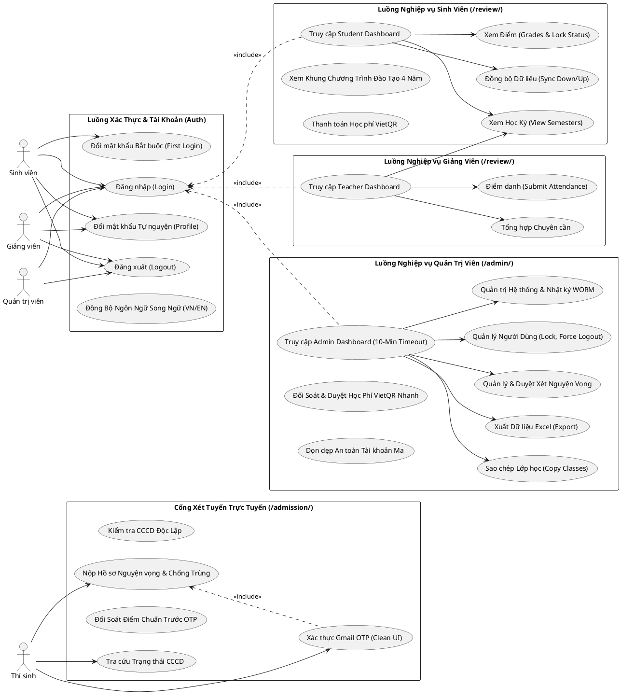
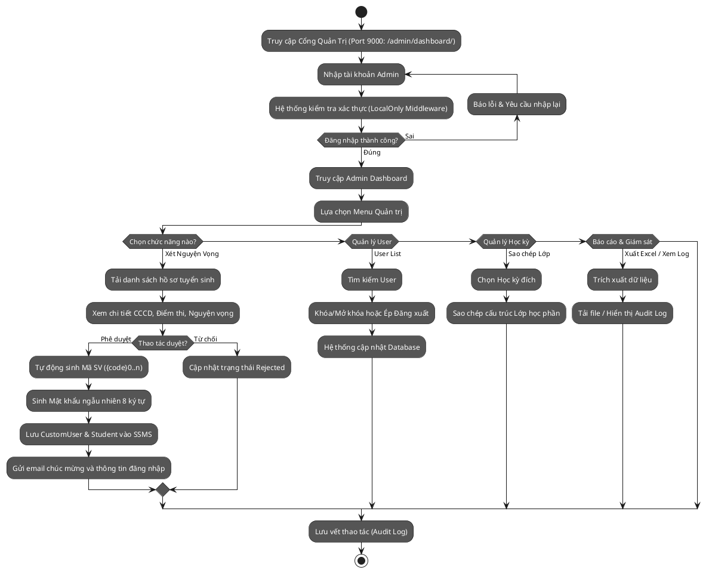
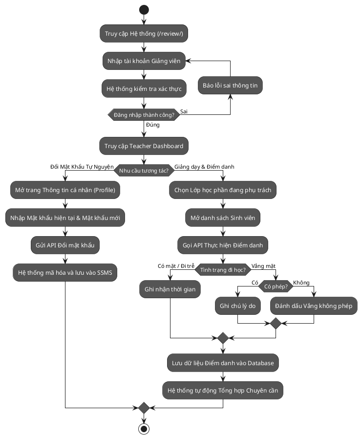
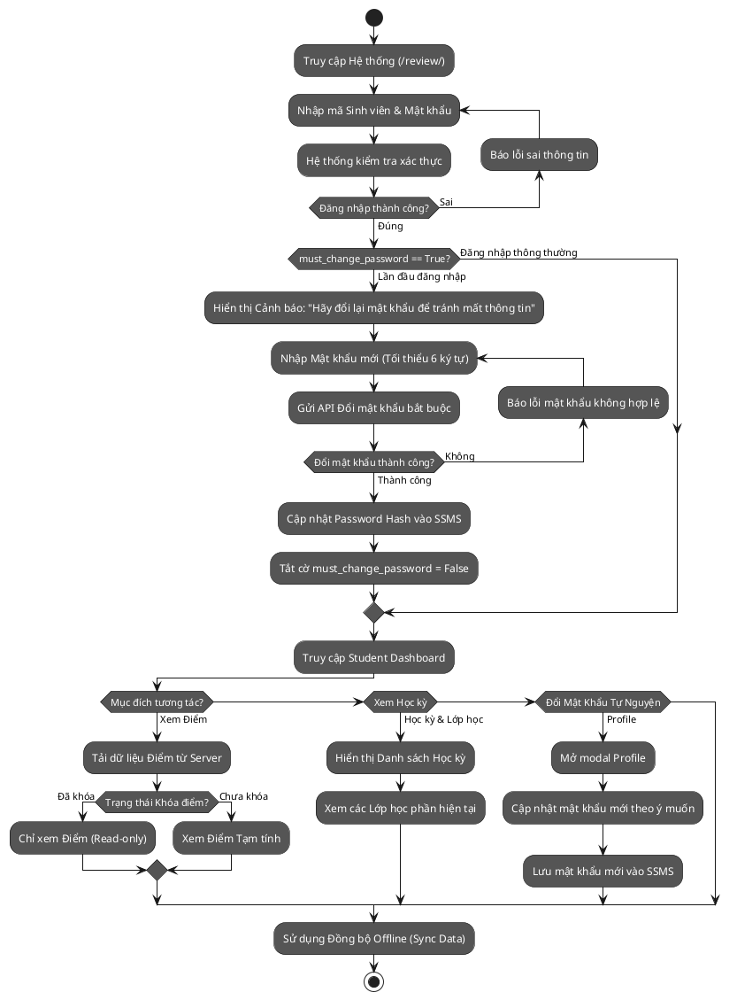
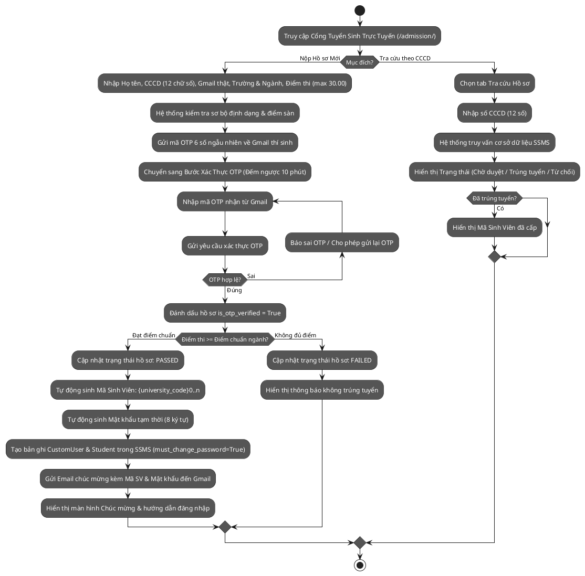

# Báo cáo Phân tích Hệ thống Student Management (UniMS)

## YÊU CẦU 1: PHÂN TÍCH VÀ VẼ BIỂU ĐỒ USE CASE (CHI TIẾT THEO LUỒNG NGHIỆP VỤ)

### 1. Phân tích Actors và Các cụm Use Cases (Modules)
Dựa vào kiến trúc hệ thống và Front-End Views, các chức năng được phân rã theo luồng nghiệp vụ của từng đối tượng (Actor) thay vì liệt kê phẳng:

**1. Thí sinh / Ứng viên (Candidate / Applicant):**
- **Luồng Xét tuyển Nguyện vọng Trực tuyến (`/admission/`):**
  - Đăng ký xét tuyển: Điền số CCCD (12 chữ số), Họ tên, Gmail thật, chọn Trường Đại học (mã số `10011`..`10021`), Ngành học và Điểm thi (thang điểm 30.00, 2 chữ số thập phân).
  - Xác thực Gmail thật bằng OTP 6 chữ số (hiệu lực 10 phút, gửi qua SMTP Gmail).
  - Tự động nhận kết quả xét tuyển: Hệ thống so sánh điểm thi với điểm chuẩn ngành (Bách Khoa 27.00 - 29.10đ, các trường khác 18.00 - 26.50đ).
  - Nhận mã Sinh viên (`{university_code}0`..`{university_code}n`) và mật khẩu tạm thời (8 ký tự alphanumeric) qua Gmail khi trúng tuyển.
  - Tra cứu trạng thái hồ sơ xét tuyển bằng số CCCD.

**2. Sinh viên (Student):**
- **Luồng Đăng nhập & Đổi mật khẩu (Auth Flow):**
  - Đăng nhập (Login) bằng mã Sinh viên và mật khẩu được cấp hoặc tự đặt.
  - Đổi mật khẩu bắt buộc lần đầu: Nếu cờ `must_change_password` bật, hệ thống hiển thị thông báo *"Hãy đổi lại mật khẩu để tránh mất thông tin"*, chặn thao tác và lưu mật khẩu mới vào SSMS.
  - Đổi mật khẩu tự nguyện trong trang Thông tin cá nhân (Profile).
- **Từ Dashboard Sinh viên (`/review/`):**
  - **Khung Chương Trình Đào Tạo 4 Năm:** Tra cứu lộ trình 8 học kỳ từ Năm 1 đến Năm 4, xem tổng số tín chỉ, môn tiên quyết và môn tự chọn theo từng chuyên ngành (menu vị trí #2 và nút bấm tại Dashboard).
  - **Học Phí & Thanh Toán VietQR:** Xem bảng kê 15 tín chỉ tiêu chuẩn cho tân sinh viên, quét mã VietQR tự động điền cú pháp chuẩn ngân hàng.
  - Xem kết quả học tập (Grades) & Trạng thái khóa điểm (Grade Lock Status).
  - Xem danh sách học kỳ (Semesters).
  - Đồng bộ dữ liệu cá nhân (Sync Data).

**3. Giảng viên (Teacher):**
- **Luồng Đăng nhập & Tài khoản:**
  - Đăng nhập (Login) -> Truy cập Giảng viên Dashboard (`/review/`).
  - Đổi mật khẩu tự nguyện trong Profile.
- **Từ Dashboard Giảng viên:**
  - Thực hiện điểm danh sinh viên (Submit Attendance).
  - Tổng hợp điểm chuyên cần (Summarize Attendance).
  - Xem thông tin học phần/học kỳ.

**4. Quản trị viên (Admin):**
- **Luồng Đăng nhập (Cổng quản trị riêng biệt Port 9000):**
  - Admin -> Đăng nhập (Login) -> Truy cập Admin Dashboard (`/admin/dashboard/`).
- **Từ Admin Dashboard, quản trị viên có thể điều hướng đến:**
  - **Xét tuyển Nguyện vọng (Admissions):** Xem danh sách hồ sơ nộp từ trang `/admission/`, lọc theo trạng thái (`submitted`, `passed`, `failed`, `rejected`), duyệt thủ công hồ sơ và tự động kích hoạt tạo mã SV/mật khẩu gửi về Gmail thí sinh, hoặc từ chối hồ sơ.
  - **Đối Soát & Duyệt Học Phí VietQR Nhanh:** Nhập Mã SV vào thanh công cụ đối soát trên Tab Sinh viên & Học phí, bấm "Duyệt Đã Thanh Toán" để gỡ cấm xem điểm / ĐKHP trong SQL Server.
  - **Dọn Dẹp An Toàn Tài Khoản Ma (Ghost Accounts Cleaner):** Quét phát hiện và xóa an toàn các tài khoản không hoạt động (0 môn học, 0 điểm thi) để làm sạch database và ghi log kiểm toán WORM.
  - **Phiên Làm Việc 10 Phút Monotonic:** Bảo vệ an ninh cấp cao, đếm lùi thời gian thực dựa trên mốc máy chủ, không bị reset khi F5/reload trang.
  - **Quản lý dữ liệu:** Sao chép cấu trúc lớp học (Copy Classes), Xuất dữ liệu ra Excel (Export).
  - **Quản trị hệ thống:** Xem thống kê hệ thống (Stats), Xem nhật ký bảo mật (Audit Logs).
  - **Quản lý người dùng:** Quản lý danh sách User, Cưỡng chế đăng xuất (Force Logout), Khóa/Mở khóa User (Toggle Active Status).

### 2. Biểu đồ Use Case (PlantUML)

### 3. Giải thích luồng nghiệp vụ
Sơ đồ trên được cấu trúc theo mô hình **Luồng phân cấp và Cổng độc lập**:
- **Cổng Xét tuyển Nguyện vọng (`/admission/`):** Phục vụ thí sinh tự do, tiếp nhận nộp hồ sơ, xác thực qua Gmail OTP thời gian thực và liên kết trực tiếp với dịch vụ cấp phát mã số sinh viên trong SSMS.
- **Cổng Học vụ Chính (`/review/`):** Yêu cầu xác thực tài khoản (`Login`). Nếu sinh viên mới trúng tuyển đăng nhập lần đầu với cờ `must_change_password = True`, hệ thống bắt buộc đổi mật khẩu trước khi cho phép tương tác với dữ liệu học tập.
- **Cổng Quản trị (`/admin/dashboard/`):** Cách ly trên Port 9000 chỉ cho phép localhost, hỗ trợ ban tuyển sinh xem danh sách, lọc và duyệt thủ công hồ sơ nguyện vọng.

---

## YÊU CẦU 2: XÂY DỰNG MÔ HÌNH TOÁN HỌC (MATHEMATICAL MODEL)

### 1. Định nghĩa các tập hợp
- **Tập hợp Người dùng & Tác nhân (Users & Actors):**
  $$U = \{u_{admin}, u_{teacher}, u_{student}, u_{candidate}\}$$
- **Tập hợp Chức năng (Functions/Use cases):**
  - Nhóm Xét tuyển Nguyện vọng: $F_{admission} = \{f_{apply}, f_{verify\_otp}, f_{check\_status}\}$
  - Nhóm Auth & Quản lý mật khẩu: $F_{auth} = \{f_{login}, f_{logout}, f_{force\_pw\_change}, f_{voluntary\_pw\_change}\}$
  - Nhóm Student: $F_{student} = \{f_{s\_dash}, f_{s\_grades}, f_{s\_semesters}, f_{s\_sync}, f_{voluntary\_pw\_change}\}$
  - Nhóm Teacher: $F_{teacher} = \{f_{t\_dash}, f_{t\_attendance}, f_{t\_summarize}, f_{voluntary\_pw\_change}\}$
  - Nhóm Admin: $F_{admin} = \{f_{a\_dash}, f_{a\_manage\_users}, f_{a\_system}, f_{a\_copy}, f_{a\_export}, f_{a\_admissions}, f_{a\_approve}, f_{a\_reject}\}$
  
  Tổng hợp hàm: $F = F_{admission} \cup F_{auth} \cup F_{student} \cup F_{teacher} \cup F_{admin}$

- **Tập hợp Trạng thái và I/O:**
  - $S_{token}: U \rightarrow \{0, 1\}$ (Hàm trạng thái Session: 1 nếu Token hợp lệ, 0 nếu không)
  - $S_{first\_login}: U_{student} \rightarrow \{0, 1\}$ (1 nếu cờ `must_change_password = True`, 0 nếu đã đổi)
  - $I$: Tập hợp dữ liệu đầu vào.
  - $O$: Tập hợp phản hồi đầu ra ($O_{success}, O_{401\_unauthorized}, O_{403\_forbidden}, O_{must\_change\_pw}$).

### 2. Ma trận phân quyền (Role-based Access Control Mapping)
Hàm ánh xạ $R: U \times F \rightarrow \{0, 1\}$ (1: Access Granted, 0: Access Denied).
- $R(u_{admin}, f_i) = 1, \forall f_i \in F$ (Admin được truy cập tất cả tài nguyên quản trị và nghiệp vụ)
- $R(u_{teacher}, f_i) = \begin{cases} 1 & \text{if } f_i \in F_{auth} \cup F_{teacher} \cup \{f_{s\_semesters}, f_{s\_sync}\} \\ 0 & \text{otherwise} \end{cases}$
- $R(u_{student}, f_i) = \begin{cases} 1 & \text{if } f_i \in F_{auth} \cup F_{student} \\ 0 & \text{otherwise} \end{cases}$
- $R(u_{candidate}, f_i) = \begin{cases} 1 & \text{if } f_i \in F_{admission} \\ 0 & \text{otherwise} \end{cases}$ (Thí sinh tương tác công khai không cần Session Token)

### 3. Mô tả luồng điều kiện (Logic vị từ) phản ánh sự phụ thuộc
Để phản ánh việc phải qua **Login/Dashboard** mới thực hiện được nghiệp vụ, và ràng buộc đổi mật khẩu lần đầu:

**Chức năng 1: Truy cập Sinh viên Dashboard & Ràng buộc Đổi mật khẩu ($f_{s\_dash}$)**
Một sinh viên đăng nhập thành công nếu mang cờ `must_change_password = True` sẽ bị chặn và buộc phải đổi mật khẩu trước:
$$ f_{s\_dash}(u_i, I_{req}) = \begin{cases} 
O_{must\_change\_pw} & \text{if } u_i \in U_{student} \land S_{token}(u_i) = 1 \land S_{first\_login}(u_i) = 1 \\ 
O_{success} & \text{if } u_i \in U_{student} \land S_{token}(u_i) = 1 \land S_{first\_login}(u_i) = 0 \\ 
O_{401\_unauthorized} & \text{if } S_{token}(u_i) = 0 
\end{cases} $$

**Chức năng 2: Phê duyệt Hồ sơ Tuyển sinh của Admin ($f_{a\_approve}$)**
Được truy cập từ Admin Dashboard trên Port 9000, chỉ cấp phép nếu user là Admin và có Session Token hợp lệ:
$$ f_{a\_approve}(u_i, I_{app\_id}) = \begin{cases} 
O_{success} & \text{if } u_i = u_{admin} \land S_{token}(u_i) = 1 \\ 
O_{403\_forbidden} & \text{if } u_i \neq u_{admin} \land S_{token}(u_i) = 1 \\ 
O_{401\_unauthorized} & \text{if } S_{token}(u_i) = 0 
\end{cases} $$

### 4. Lưu đồ Nghiệp vụ Thực tế cho từng Tác nhân (Business Process / User Journey Flowcharts)

Để người dùng cuối có thể dễ dàng đọc hiểu luồng hoạt động thực tế (thay vì luồng kiểm tra bảo mật ở mức hệ thống), dưới đây là các lưu đồ nghiệp vụ (User Journey) thể hiện chi tiết hành trình từ lúc người dùng tương tác đến khi kết thúc quy trình.

#### 4.1. Luồng Nghiệp vụ: Quản trị viên (Admin)
Mô phỏng hành trình quản trị hệ thống, thao tác với người dùng, dữ liệu và duyệt xét tuyển.

#### 4.2. Luồng Nghiệp vụ: Giảng viên (Teacher)
Mô phỏng hành trình giảng viên truy cập lớp học phần và thực hiện tác vụ chuyên môn (như Điểm danh và Đổi mật khẩu).

#### 4.3. Luồng Nghiệp vụ: Sinh viên (Student)
Mô phỏng hành trình Sinh viên tham gia vào hệ thống, kiểm tra đổi mật khẩu bắt buộc và tra cứu thông tin học tập.

#### 4.4. Luồng Nghiệp vụ: Thí sinh Xét tuyển Nguyện vọng (Candidate / Applicant)
Mô phỏng hành trình thí sinh nộp hồ sơ trực tuyến tại `/admission/`, xác thực Gmail OTP, nhận mã SV tự động và tra cứu trạng thái theo CCCD.

