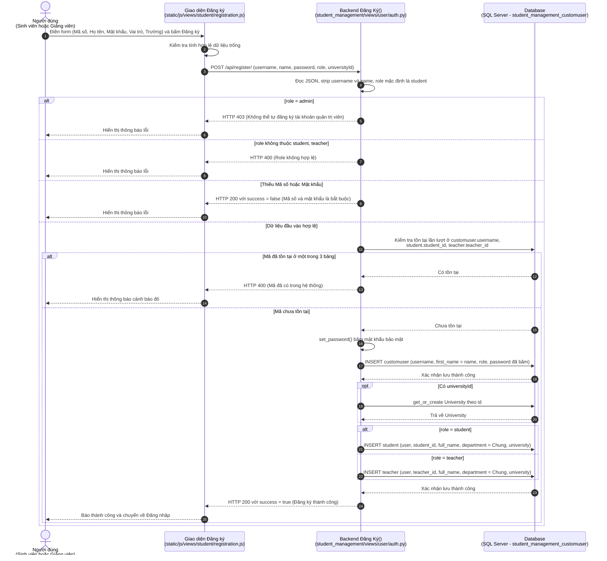
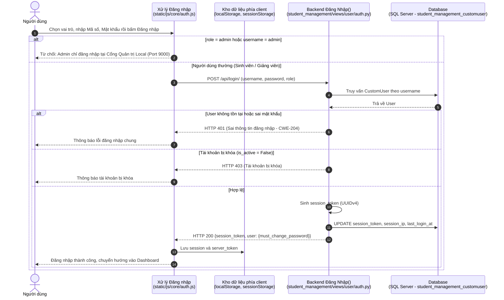
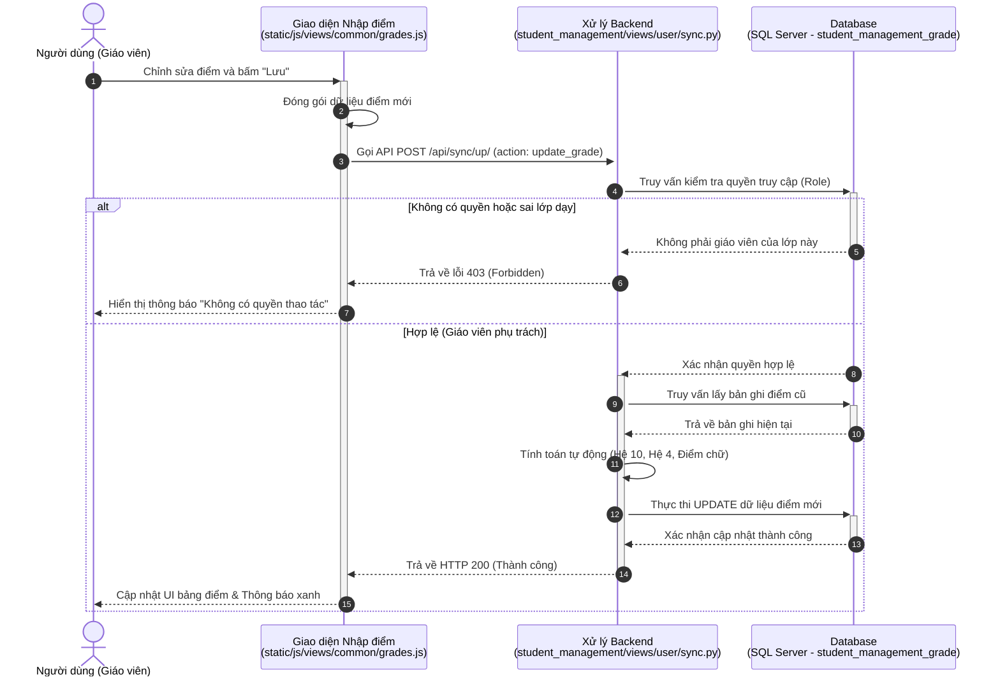
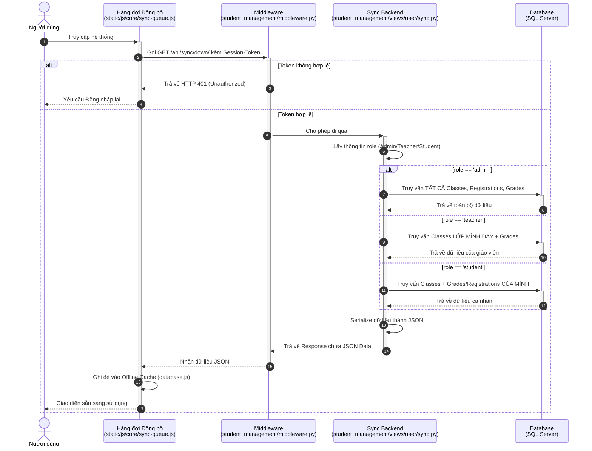
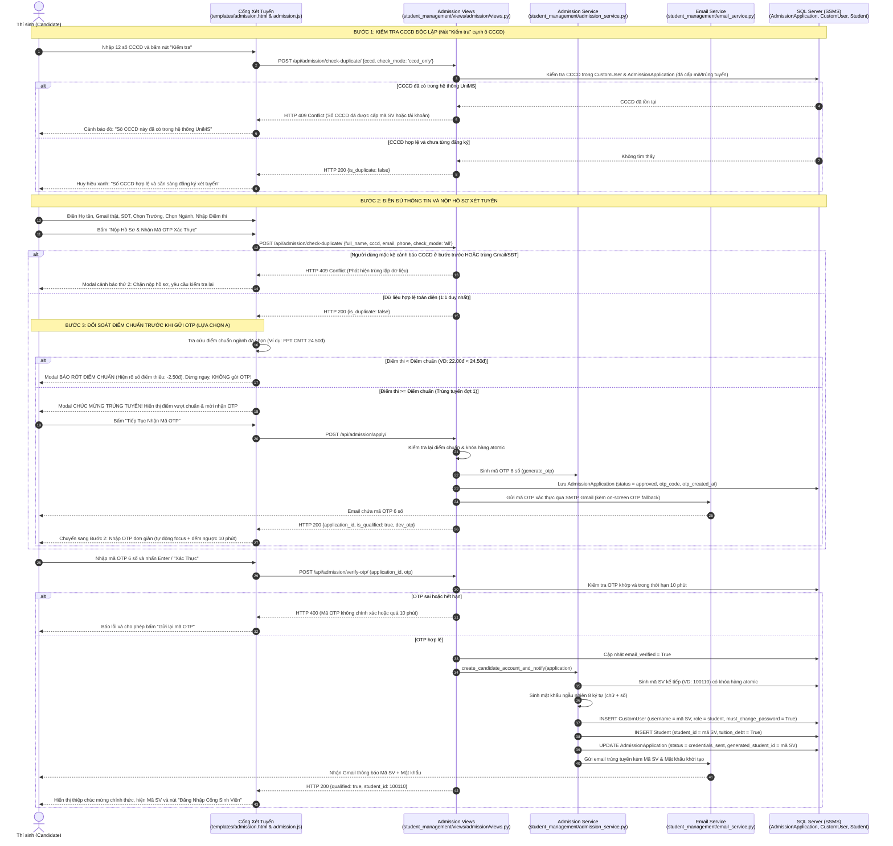
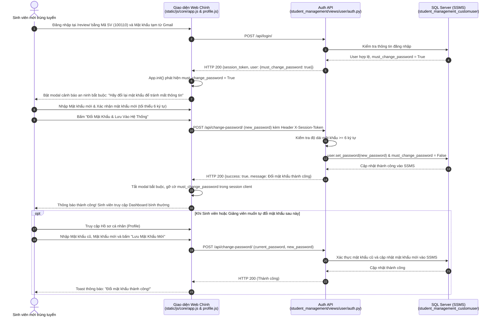
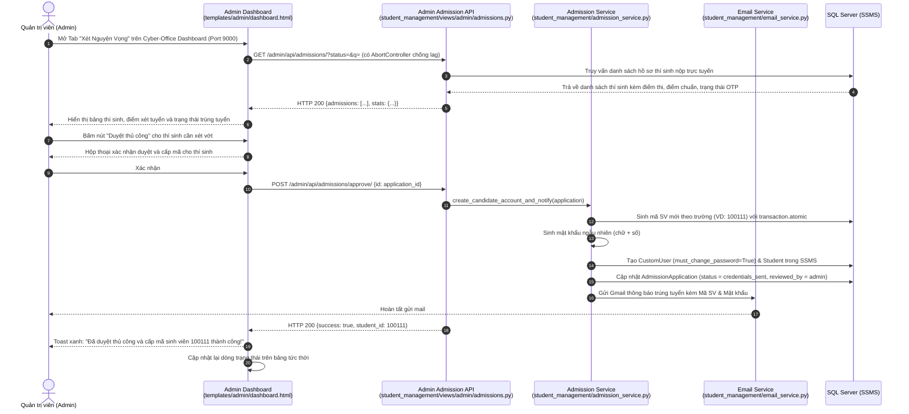
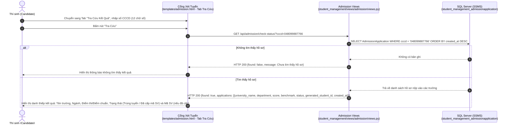
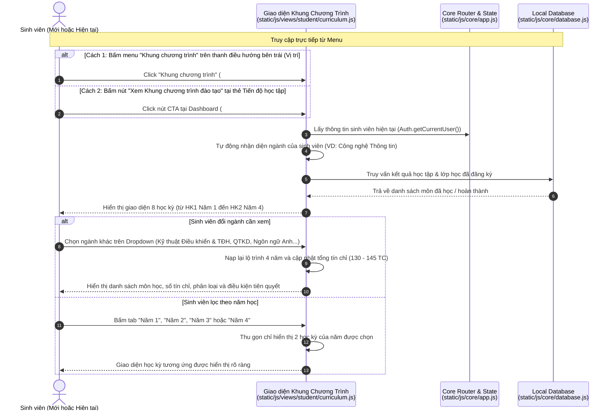
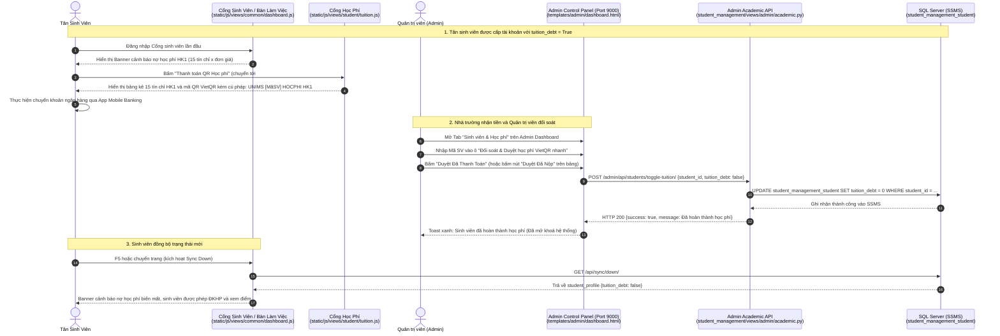

# BIỂU ĐỒ TUẦN TỰ (CHUẨN UML & ĐƯỜNG DẪN FILE TRỰC TIẾP)

> **CÁCH VẼ TỰ ĐỘNG TRÊN DIAGRAMS.NET (DRAW.IO):**
> 1. Trên thanh menu chọn: **Arrange** -> **Insert** -> **Advanced** -> **Mermaid...**
> 2. Copy đoạn code bên dưới chữ ````mermaid` của từng chức năng và dán vào hộp thoại.
> *(Các biểu đồ đã được cập nhật đường dẫn tuyệt đối trỏ thẳng tới các file Frontend/Backend tương ứng)*

---

## 1. Biểu đồ Tuần tự: Chức năng Đăng ký



---

## 2. Biểu đồ Tuần tự: Chức năng Đăng nhập



---

## 3. Biểu đồ Tuần tự: Chức năng Nhập Điểm & Tính GPA



---

## 4. Biểu đồ Tuần tự: Luồng Đồng bộ Dữ liệu (Sync Down)



---

## 5. Biểu đồ Tuần tự: Đăng Ký Xét Nguyện Vọng, Gửi OTP Gmail & Cấp Mã Sinh Viên Tự Động



---

## 6. Biểu đồ Tuần tự: Quy Trình Đổi Mật Khẩu Bắt Buộc (Lần Đầu) & Tự Nguyện



---

## 7. Biểu đồ Tuần tự: Quản Trị Viên Duyệt Hồ Sơ Thủ Công Trên Admin Dashboard



---

## 8. Biểu đồ Tuần tự: Tra Cứu Kết Quả Xét Tuyển & Mã Sinh Viên Bằng Số CCCD




---

## 9. Biểu đồ Tuần tự: Khung Chương Trình Đào Tạo 4 Năm & Tra Cứu Lộ Trình Học Tập



---

## 10. Biểu đồ Tuần tự: Nợ Học Phí Tân Sinh Viên, Quét Mã VietQR & Admin Duyệt Thanh Toán


