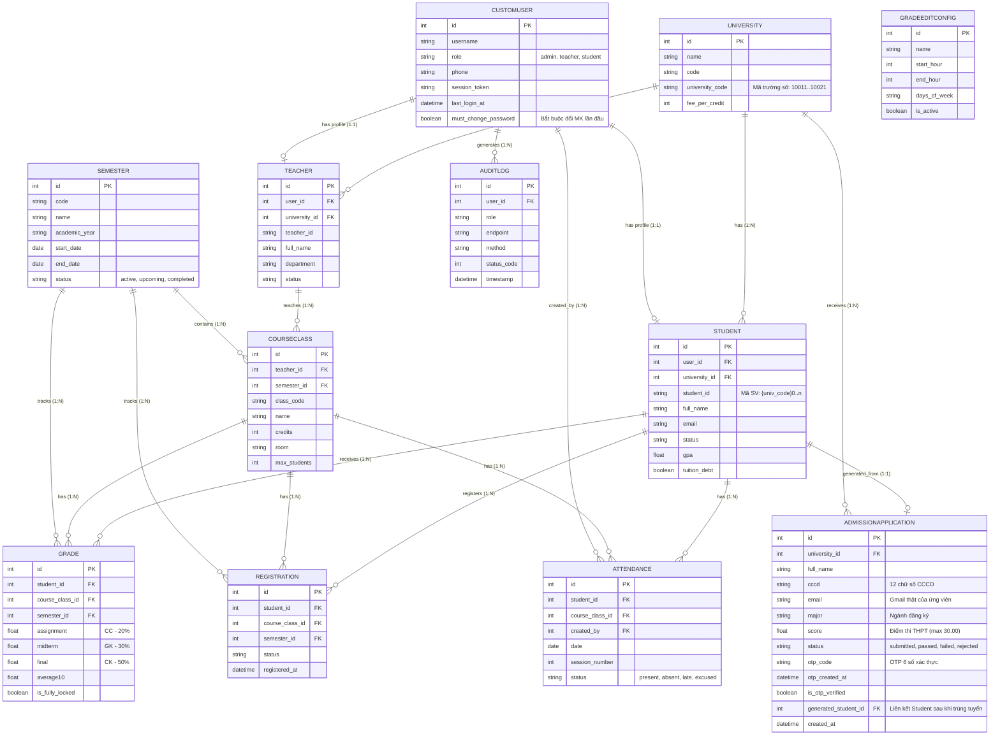
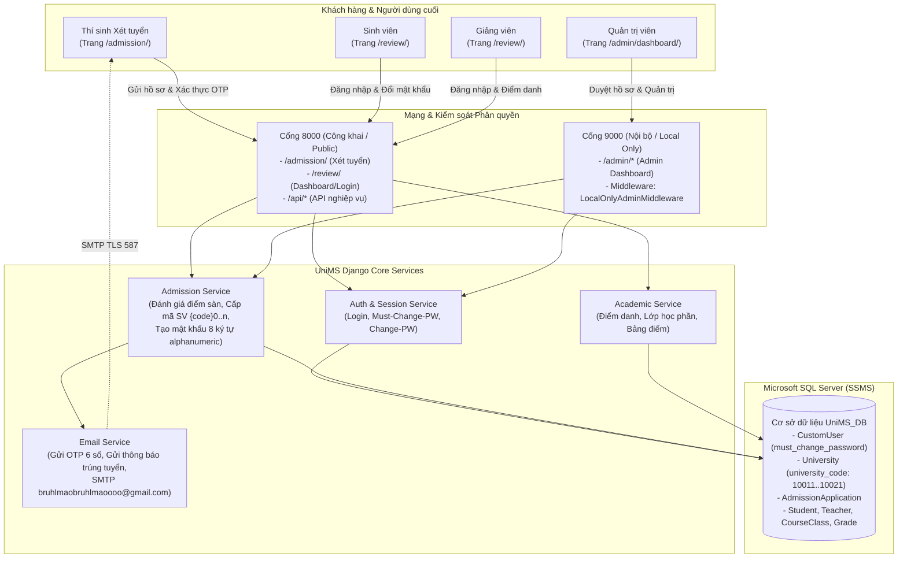

# Mô hình Cơ sở dữ liệu (Entity Relationship Diagram) & Kiến trúc Hệ thống

Dưới đây là sơ đồ thực thể liên kết (ERD) và sơ đồ kiến trúc hệ thống được trích xuất từ các Models và Services chính của hệ thống Student Management (UniMS), bao gồm các tính năng Đăng ký xét tuyển nguyện vọng, Xác thực Gmail OTP, Tự động cấp mã sinh viên và Đổi mật khẩu.

---

### 1. Sơ đồ ERD (Mermaid)

### 2. Sơ đồ Kiến trúc Hệ thống UniMS (Mermaid Architecture)

### 3. Giải thích các Thực thể và Mối quan hệ Mới:
- **`AdmissionApplication` (Hồ sơ xét tuyển):** Lưu trữ thông tin thí sinh nộp hồ sơ, bao gồm họ tên, CCCD (12 số), Gmail thật, ngành xét tuyển, điểm thi THPT (thang điểm 30.00 với 2 chữ số thập phân), mã OTP xác thực (hết hạn sau 10 phút) và trạng thái xét tuyển (`submitted`, `passed`, `failed`, `rejected`).
- **`University.university_code`:** Lưu mã định danh số của trường đại học, bắt đầu từ `10011` (Bách Khoa - DUT) và tăng dần theo thứ tự: `10012` (Duy Tân - DTU), `10013` (FPT), ..., `10021` (Sư phạm Kỹ thuật - UTE).
- **`CustomUser.must_change_password`:** Cờ boolean đánh dấu tài khoản vừa được cấp qua xét tuyển, bắt buộc sinh viên phải đổi mật khẩu ngay lần đầu tiên đăng nhập vào cổng chính `/review/`.
- **Liên kết `Student` và `AdmissionApplication`:** Quan hệ 1:1 tùy chọn (`generated_from`), cho phép truy vết sinh viên trúng tuyển từ hồ sơ đăng ký nguyện vọng ban đầu.
